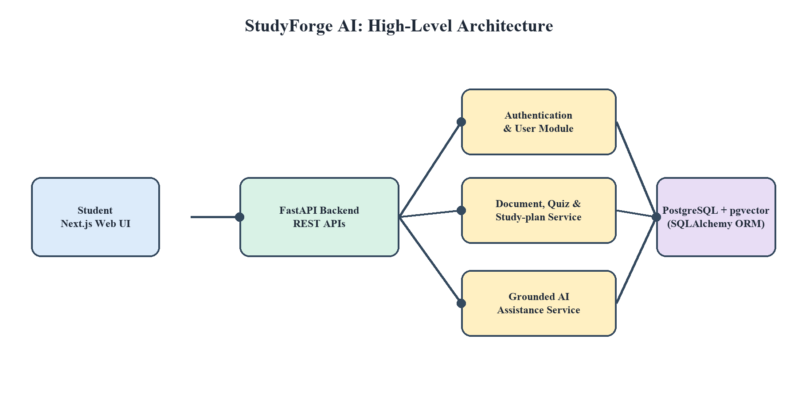
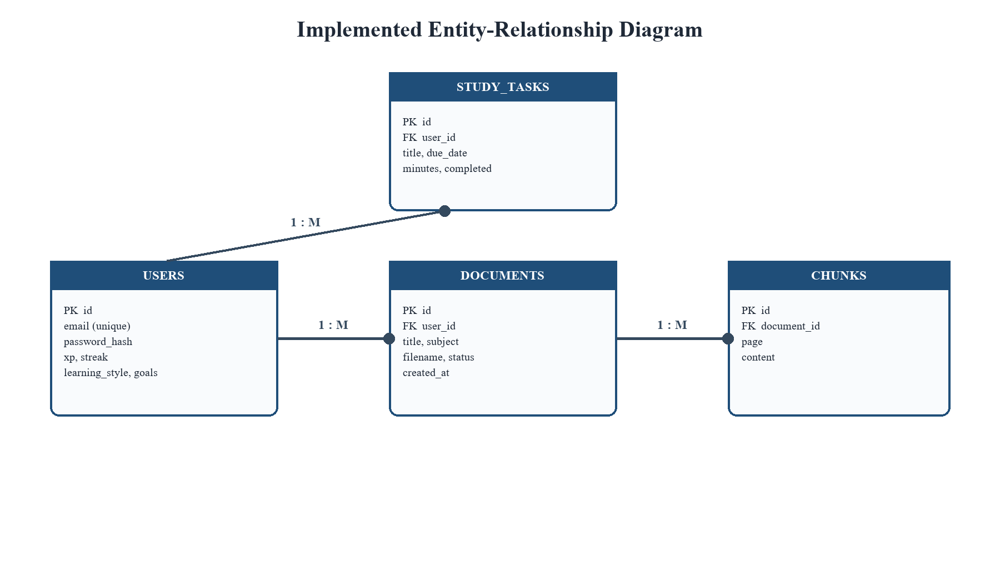

<div align="center">

# StudyForge AI · v1 Prototype

**The first full-stack version of StudyForge: an AI-assisted study platform that turns PDFs into cited answers, quizzes, study plans and XP-based progress.**

<p>
  
  
  
  
  
  
</p>

</div>

> [!TIP]
> **Looking for the latest version?** StudyForge has since evolved into a richer workspace with streaming AI answers, a planner, a revision tracker, flashcards and dark mode. See **[STUDYFORGE-AI-](https://github.com/akshita-sharda/STUDYFORGE-AI-)**.
> This repository preserves the v1 architecture: JWT auth, PostgreSQL/pgvector and a Dockerised deployment.

## Architecture



<details>
<summary><b>Entity-relationship diagram</b></summary>
<br>

</details>


## Features
- JWT signup/login, protected client pages, onboarding preferences
- PDF upload, page-wise extraction with PyMuPDF, stored chunks and source citations
- Grounded chat: reports insufficient evidence instead of fabricating answers
- Quiz generation/submission and XP tracking, study-plan task completion, dashboard progress
- Dark-first responsive glass UI with an elegant landing, library, workspace, quiz, flashcard, and planning flows

> **Demo AI mode:** `MOCK_AI=true` (the default) visibly creates deterministic template quiz content based on uploaded text. Chat remains extractive and cited. Replace this service layer with a production LLM/embedding provider before relying on generative outputs.

## Stack overview
`frontend/` is Next.js App Router + TypeScript + Tailwind and talks only to `backend/`. `backend/` is FastAPI, SQLAlchemy, PyMuPDF extraction, JWT security, and PostgreSQL-compatible persistence. Docker runs Postgres with pgvector, the API, and the web app.

## Quick start with Docker
1. Copy `.env.example` to `.env` and set `SECRET_KEY` plus database credentials.
2. From this repository root, run `docker compose up --build`.
3. Open `http://localhost:3000`; API docs are at `http://localhost:8000/docs`.

## Local development
Backend:
```powershell
cd backend
python -m venv .venv
.\.venv\Scripts\Activate.ps1
pip install -r requirements.txt
$env:DATABASE_URL='sqlite:///./studyforge.db'
uvicorn app.main:app --reload
```
Frontend (new terminal):
```powershell
cd frontend
npm install
$env:NEXT_PUBLIC_API_URL='http://localhost:8000/api/v1'
npm run dev
```

## Environment
`DATABASE_URL`, `SECRET_KEY`, `FRONTEND_URL`, `MOCK_AI`, `OPENAI_API_KEY`, `OPENAI_MODEL`, and `NEXT_PUBLIC_API_URL` are documented in `.env.example`. Never put an LLM key in `NEXT_PUBLIC_*` variables.

## API overview
- `POST /api/v1/auth/signup`, `POST /api/v1/auth/login`, `GET /api/v1/auth/me`
- `GET|POST /api/v1/documents`, `DELETE /api/v1/documents/{id}`
- `POST /api/v1/chat`, `POST /api/v1/quizzes/generate`, `POST /api/v1/quizzes/submit`
- `GET /api/v1/progress`, `GET|POST /api/v1/study-plan`, `PATCH /api/v1/study-plan/{id}`

## Checks
```powershell
cd backend; pytest
cd ../frontend; npm run build
```

## Next production upgrades
Add asynchronous PDF processing, real pgvector embeddings/search, rate limiting, a managed object store, refresh-token cookie sessions, and an LLM provider implementation with schema-enforced quiz/flashcard JSON.

## Project documents

The [`docs/synopsis`](docs/synopsis) folder contains the project synopsis and a complete technical explanation (PDF and DOCX).

---

<div align="center">

**Designed and built by [Akshita Sharda](https://github.com/akshita-sharda)**

</div>
